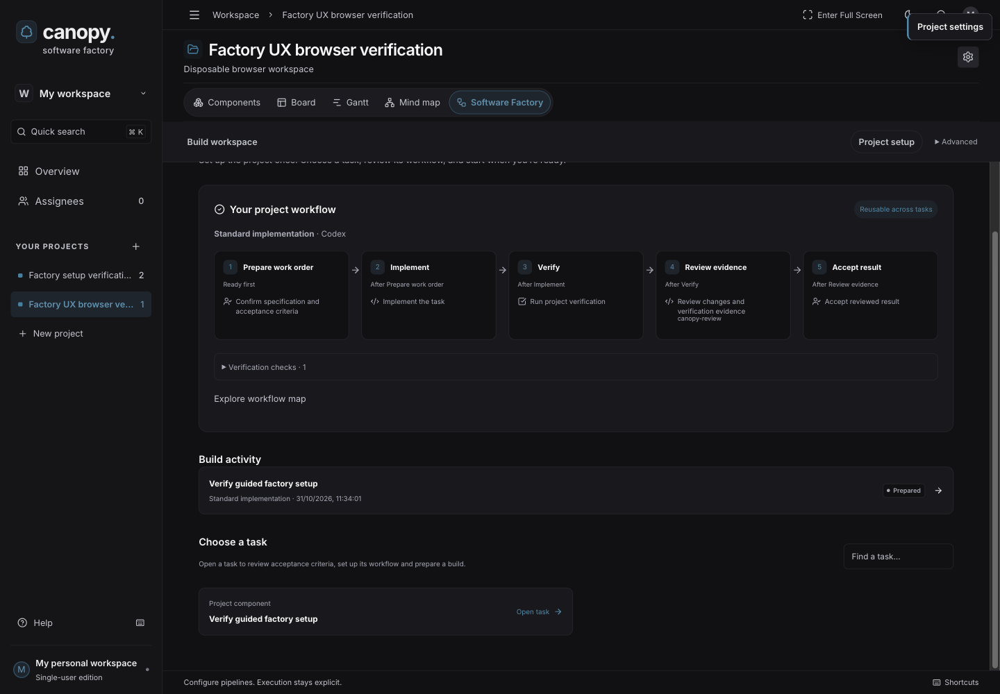
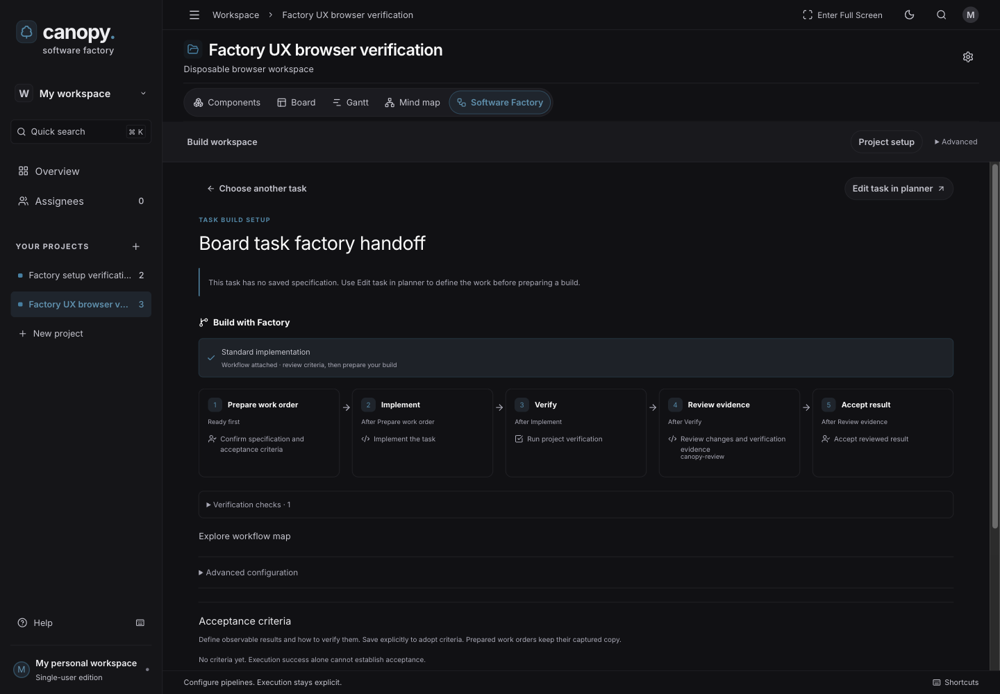
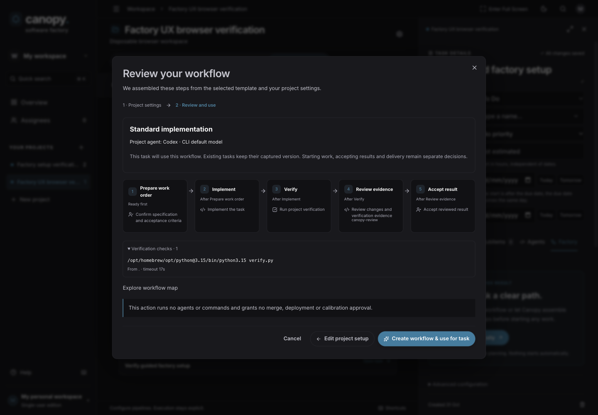

# Guided factory setup

The planner works as before. Factory setup, task preparation, execution and
acceptance remain separate actions. No existing project is configured by upgrade.

## Configure once

1. Open a project's **Software Factory → Set up automatically**.
2. Connect its actual repository and agent, or reuse its saved connection.
3. Choose a work type from the configured templates.
4. For a workflow with verification, add the repository's actual build/test
   commands in order. Set each directory and timeout explicitly. Commands execute
   directly; quote arguments containing spaces. Shell operators and expansion
   are unsupported. Add another check for another command.
5. Review the suggested installed skills. Unavailable suggestions stay visible as
   gaps and are not selected. **Customize skills and workflow name** offers the
   installed catalogue and explicit references.
6. Choose **Review workflow**, inspect all stages and exact checks, then
   **Save project workflow**. **Explore workflow map** uses the existing React Flow
   view. Setup runs nothing.

## Use it for a task

Choose a task in the factory workspace to open its focused build view, then
choose **Set up automatically**. The existing **Task → Factory** tab offers the
same flow. **Edit task in planner** opens the full task editor when needed. If project setup exists, review
it and choose **Use workflow for this task**. Otherwise complete the same setup
and choose **Create workflow & use for task**. Creation, publication and attachment
are one transaction. Subsequent tasks reuse the same published workflow.

Add and save measurable acceptance criteria. **Prepare build** checks prerequisites
and captures the work order. Missing specifications or other requirements remain
visible. A prepared build still needs **Start run** and its explicit confirmation.
Preparation never starts an agent or command.

## Change a workflow

**Project setup → Edit project setup** changes the managed workflow. New settings
publish a new version; existing tasks keep their attached versions. The same
inputs reuse the existing version. Changing template provenance creates a new
correctly attributed pipeline, preserving history.

**Advanced → Pipeline designer** retains custom stages, versions and overrides.
Task-level **Advanced configuration** can explicitly choose another version or
tailor steps. Guided setup refuses to overwrite an existing different attachment
or an advanced draft/publication it no longer owns. Advanced model routing,
intake and calibration remain available under **Advanced**.

## Contract and validation

`GET /api/factory/projects/{id}/setup` reads the saved setup, configured templates
and project connection. `POST .../setup/preview` validates without saving.
`PUT .../setup` publishes and optionally attaches one task atomically.
`POST /api/factory/tasks/{id}/use-project-setup` attaches the reviewed version.
Mutations require the current project revision; stale or conflicting inputs return
409. Native EF/DuckDB stores the project-to-version reference. Planner fields,
task status and execution/delivery/calibration policies are unchanged.

Defaults and suggested role skills come from `Factory:Setup` configuration;
workflow definitions and provenance come from `factory-templates.json`. Setup is
deterministic template assembly. It does not infer commands from source files,
install tools, authenticate a CLI, or establish model/review quality.

Validation includes real native API rollback/reuse/versioning/restart checks,
an upgrade from a checkpointed prior database, command round-trip checks, and
desktop/mobile-viewport browser interaction. Screenshots show a disposable native
workspace using explicit local Python verification and agent availability fixtures.
No live model was dispatched. Phone viewport testing does not establish physical
device compatibility.
