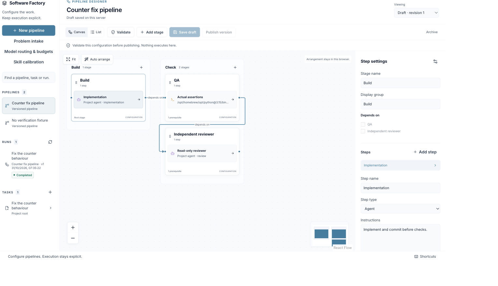
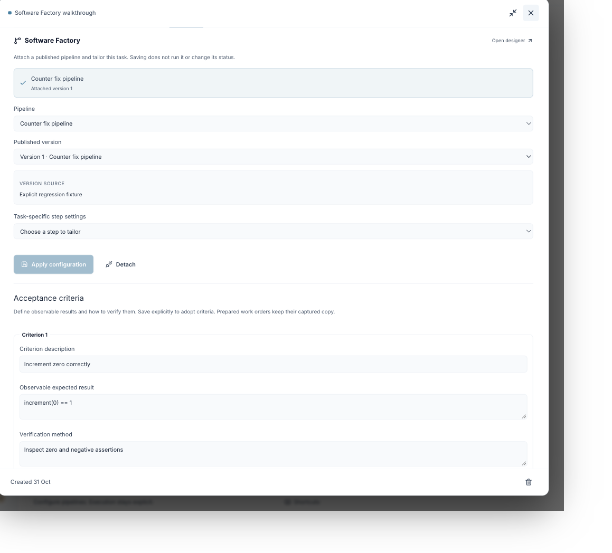
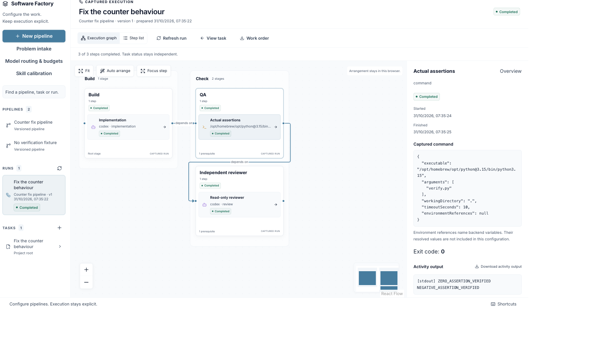
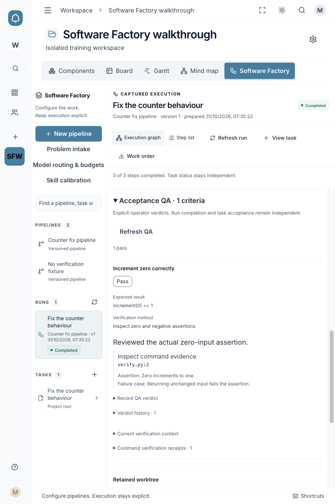
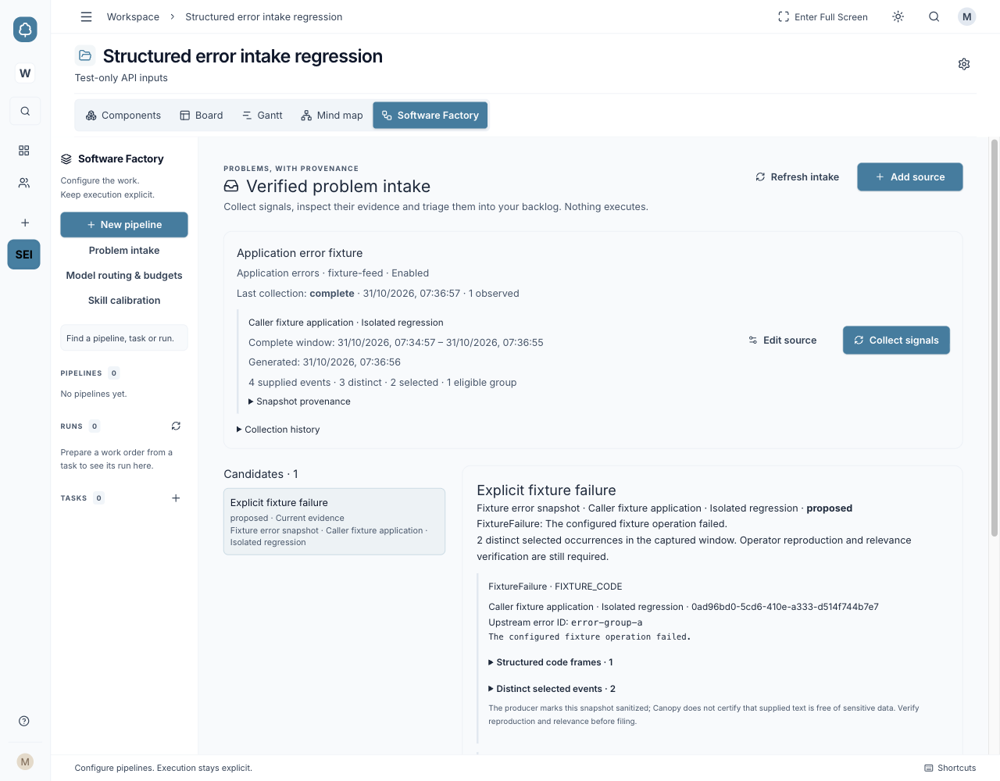

# Phase 1 Software Factory quick start

Canopy's single-user release takes a task from a specification through a configured
pipeline, verification, review and controlled delivery. Planning and writing specs
also work independently. Saving settings, publishing a pipeline and preparing a
run do not start work.

Open **http://127.0.0.1:5274**. Installation and startup: [Run](../README.md#run).

## What is delivered

- Versioned pipelines, templates, custom stages, installed skills and task overrides.
- Captured runs, React Flow inspection, manual gates, cancellation and opt-in parallel stages.
- Acceptance QA, independent review, persistent findings and bounded repair.
- Controlled GitHub delivery, configured deployment environments and recovery evidence.
- Verified issue, recurring-finding, application-error and analytics intake.
- Post-delivery proposals for improvements to selected existing skills.

Screenshots show isolated training workspaces using local provider fixtures.
Expand an image to read the controls; use your own repositories, commands and skills.

## Before your first run

1. Open **Project settings → Agent connection**. Choose an existing local Git
   repository, base ref and available agent. Install and sign in to the chosen CLI
   separately. Set the project's model and effort where needed.
2. Make the required skills, tools and verification commands available locally.
   [Skill setup](FACTORY-SKILLS.md) explains the configured catalogue.
3. Start with one small task and observable acceptance criteria. Keep the app on
   loopback: Phase 1 has one backend process owning native DuckDB; team login is
   a later phase.

## 1 Configure a pipeline

Open the project's **Software Factory** tab and choose **New pipeline**. Select an
available template or **Custom pipeline**. A useful starting flow is implementation,
verification commands and an independent read-only reviewer.

Select a stage or step to edit instructions, permissions, agent settings and skills.
Command steps need an executable, arguments, working directory and timeout.
Dependencies control order; dragging boxes changes layout.
For PR delivery, include committing the candidate in the implementation
instructions, before the verification stage.

Choose **Validate → Save draft → Publish version**. Published versions are
immutable; later edits become a new version.

## 2 Attach a task and prepare work

1. Open a task and write its **Specification**.
2. In **Factory**, select the pipeline and published version. Add task-specific
   overrides if needed, then **Apply configuration**.
3. Add **Acceptance criteria**: description, observable expected result and
   verification method. Clear **Needs clarification** once the criterion is
   testable, then **Save criteria**.
4. Choose **Check readiness**, resolve errors, then **Prepare run**. This captures
   the task, pipeline, settings and skill versions. It does not execute them.

## 3 Execute and inspect

Choose **Start run → Start captured run**. Open it from **Runs** or **Open execution
view**. Select a step for command output, reports, diffs and evidence, or use
**Step list**.

Approve manual gates explicitly. Use **Stop run** to cancel; closing the view
does not stop execution. A backend restart interrupts unfinished work without
automatically replaying it.

## 4 Verify the result and deliver

Open **Acceptance QA** in the run overview. Record each criterion’s verdict and
rationale. Pass/fail needs the command, asserting test path/line, what it proves
and the defect it detects. Check the assertion yourself; agent completion does
not establish acceptance.

Open **Independent review**. Start a round, record the independent assessment,
recheck earlier findings, add new findings and submit the structured verdict.
Code or input changes make affected evidence stale and require fresh verification.

For delivery, ensure the candidate is committed **before final QA and review**.
In **Controlled PR delivery**, choose **Edit delivery policy**, configure it,
capture the verified candidate and publish its draft PR. Mark the PR ready on GitHub; required checks
and strict branch protection must pass before separate merge approval and merge.

Deployment and recovery need separate targets and approvals. Inspect revision,
health and persistence outcomes. Mark the planning task complete when you accept
the result; execution, review and merge leave that decision to you. [Delivery details](FACTORY-DELIVERY.md) ·
[Deployment setup](FACTORY-DEPLOYMENTS.md).

## Optional features

| Feature | How to use it |
| --- | --- |
| Problem intake | Open **Problem intake → Add source → Collect signals**. Inspect coverage and evidence, enter a rationale, **Verify current evidence**, then preview filing or linking. Error and analytics feeds need backend producer configuration first. [Setup](FACTORY-INTAKE.md) |
| Routing and parallelism | Open **Model routing & budgets**. Adopt explicit role routes and invocation/time limits; enable concurrent stages only when wanted. Unsupported hard token/currency caps block dispatch; uncapped cost needs explicit consent. [Policy](FACTORY-EXECUTION-POLICY.md) · [Parallel stages](FACTORY-PARALLEL-EXECUTION.md) |
| Bounded repair | In the run overview, open **Bounded repair and verification**. Configure published repair plans and limits, select failed criteria/findings, prepare and explicitly start. Recheck QA and review for each attempt. [Setup](FACTORY-REPAIR.md) |
| Skill calibration | Open **Skill calibration** to select an installed calibrator, existing targets and execution limits. After verified delivery, prepare/start from the delivery inspector, review the diff and adopt explicitly. Backend edit roots are required; it is disabled by default. [Setup](FACTORY-CALIBRATION.md) |

## If something blocks progress

- **Readiness errors:** fix the named connection, specification, skill, tool or
  prerequisite, then check again. Readiness does not prove CLI credentials work.
- **Stale evidence:** refresh the inspector and run fresh verification. Changed
  task inputs require a new captured work order.
- **Uncertain or partial outcome:** inspect saved state and use the offered
  reconciliation action. Do not assume a lost response means nothing happened.
  Partial skill adoption needs explicit reconciliation or acknowledgment.

Back up DuckDB with the backend stopped; retain any WAL alongside it. Browser
recovery drafts and exported project JSON do not replace a database backup.

For the full delivered scope, see the [roadmap](SOFTWARE-FACTORY-ROADMAP.md).
